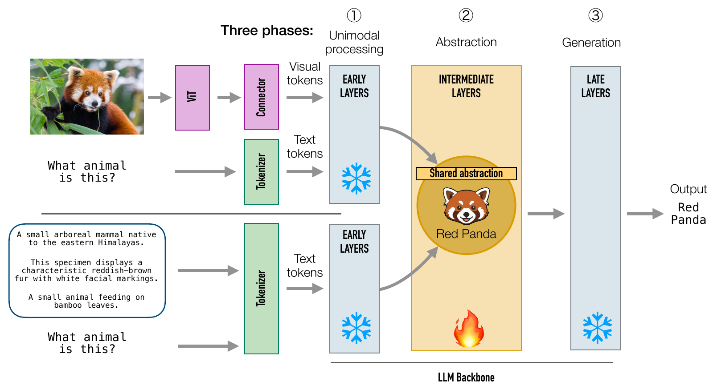

# Visual Instruction Tuning Aligns Modalities through Abstraction

[](https://arxiv.org/abs/2606.03871)
[](https://luisfpal.github.io/multimodal_finetuned_representations/)
[](LICENSE)

**Luis Palacios\*, Lorenzo Basile\*, Diego Doimo†, Alberto Cazzaniga†**  
Area Science Park, Trieste, Italy · \* Equal contribution. † Equal supervision.

[**Paper**](https://arxiv.org/abs/2606.03871) · [**Project page**](https://luisfpal.github.io/multimodal_finetuned_representations/) · [**Models and data**](#models-and-data) · [**Citation**](#citation)

<p align="center"></p>

Code to reproduce the figures of the paper: the experiments (layer interventions, probing,
representation geometry, benchmarks of the localized fine-tuning) and one plot script per figure.

## Contents

- [Repository structure](#repository-structure)
- [Setup](#setup)
- [Models and data](#models-and-data)
- [Figures](#figures)
- [Running the experiments](#running-the-experiments)
- [Citation](#citation)
- [License](#license)

## Repository structure

```text
multimodal_abstraction/
├── figures/                          one plot script per figure: PDF in out/, PNG in out_png/
├── scripts/                          experiment entry points
│   ├── interventions/                multimodal.py, text.py: layer skip, attention knockout
│   ├── probing/                      label_overlap.py, logit_lens.py, linguistic_probing.py,
│   │                                 extract_coco_embeddings.py + retrieval.py, download_senteval.sh
│   ├── geometry/                     similarity_multimodal.py, imbalance_planes.py,
│   │                                 similarity_llama_vision.py
│   └── finetuning/                   benchmarks.py, compositionality.py, ARO / SugarCrepe downloads
├── slurm/                            one launcher per experiment; env.sh holds the paths
├── utils/
│   ├── data/                         datasets, prompts, collate functions (representation experiments)
│   ├── models/                       loading.py, layers.py (decoder layers), layer_skipping.py
│   │   ├── llava/                    per model family: patch_<family>.py (interventions),
│   │   ├── onevision/                patch_<family>_eval.py (image-removed baselines),
│   │   ├── internvl/                 compatibility shims, lmms-eval / lm-eval wrappers
│   │   ├── cambrian/
│   │   └── llama/                    cross-attention knockout of Llama-3.2-Vision
│   ├── representations/              residual_stream.py: last-token residual stream per layer;
│   │                                 metrics.py: CKA, neighborhood overlap, imbalance, label overlap
│   ├── evaluation/                   lmms-eval image settings, MMBench LLM judge
│   ├── retrieval/                    COCO retrieval (appendix)
│   ├── linguistic_probing/           SentEval linguistic probing (appendix)
│   └── seed.py
├── data/
│   ├── splits/                       fixed VQAv2 / COCO-QA splits (similarity experiments)
│   └── probing/                      SentEval files (scripts/probing/download_senteval.sh)
├── third_party/                      vendored Cambrian and ARO code
├── setup_env.sh                      conda environment (Setup)
└── requirements.txt
```

The [runs](#running-the-experiments) create `results/` and `representations/` (saved activations). The scripts in  `figures/` read the files in `results/` to generate the paper plots. 

## Setup

flash-attn is optional and affects only InternVL2-8B. Without flash-attention, InternVL2-8B runs with eager attention (1.5-2 times slower). Every other model uses PyTorch's sdpa attention, or eager attention in the interventions that edit the attention mask, whether flash-attn is installed or not.

```bash
bash setup_env.sh                    # conda env in ./env: Python 3.12, torch 2.8 (CUDA 12.8), flash-attn 2.8.3,
                                     # transformers 4.57.6, lmms-eval 0.7.1, lm-eval 0.4.9.2 (pinned commits)
NO_FLASH_ATTN=1 bash setup_env.sh    # the same environment without flash-attn
source env/bin/activate
```

When installing by hand, follow `setup_env.sh` and leave out its `pip install flash-attn` line.

Models and datasets are downloaded from the Hugging Face Hub into `HF_HOME` (set it, together with
the other paths, at the top of `slurm/env.sh`); they are listed under [Models and data](#models-and-data).

MMBench is scored by an LLM judge: export `OPENAI_API_KEY`, `OPENAI_API_URL` and `MODEL_VERSION`
(any OpenAI-compatible endpoint) before running the benchmark or intervention jobs that include it.
The judge is only called for answers that are not a plain option letter.

## Models and data

Each model has one implementation, loaded the same way by every experiment (benchmarks,
interventions, representation analyses); the repository's patches wrap it for the interventions and
the image-blind baselines. The code loads the Hub's current revision; the revisions below are the ones
used for the verification of this repository.

| Model | Checkpoints (revision) | Implementation |
| --- | --- | --- |
| LLaVA-1.5 7B / 13B | `lbasile/llava_7b` (393f5c3), `lbasile/llava_13b` (fc68464): LLaVA-1.5 trained with the official recipe from Vicuna-v1.5; fine-tuned `lbasile/llava_7b_6_17` (8a0b714), `lbasile/llava_7b_6_17_complementary` (fcff58d); sliding-window fine-tuned `lbasile/llava_7b_0_8` (a0be08d), `_4_12` (9506665), `_8_16` (b8184ac), `_12_20` (88c4551), `_16_24` (370867e), `_20_28` (f9c697b), `_24_32` (7d2a79c); pre-trained connector + LLM `l11p/llava-v1.5-7b-pretrained-lbasile` (b75c6da), `l11p/llava-v1.5-13b-pretrained-lbasile` (0782b79) | transformers 4.57.6 `LlavaForConditionalGeneration`, bf16 |
| LLaVA-OneVision-1.5 4B / 8B | `lmms-lab/LLaVA-OneVision-1.5-4B-Instruct` (ae6819d), `-4B-Base` (9724845), `-8B-Instruct` (e137910), `-8B-Base` (0ee4560); fine-tuned `lbasile/LLaVA-OneVision-1.5-4B` (c52d609), `lbasile/LLaVA-OneVision-1.5-4B-8-26` (372071f), `lbasile/LLaVA-OneVision-1.5-4B-8-26-comp` (ffdfb3c); sliding-window fine-tuned `lbasile/LLaVA-OneVision-1.5-4B-0-8` (84c05f6), `-4-12` (d141546), `-8-16` (4d636fa), `-12-20` (32878c1), `-16-24` (4e23970), `-20-28` (ebf80b9), `-24-32` (f7385e4), `-28-36` (6163b2e) | the checkpoints' remote code `LLaVAOneVision1_5_ForConditionalGeneration` (`trust_remote_code`), bf16; the copies shipped with the checkpoints differ only in an import and two variable definitions |
| InternVL2-8B | `OpenGVLab/InternVL2-8B` (6fb9ad6); pre-trained `OpenGVLab/InternVL2-Pretrain-Models/InternVL2-8B-Pretrain` (287efab) | the remote code `InternVLChatModel` of `OpenGVLab/InternVL2-8B`, also for the pre-trained weights, bf16; up to 12 image tiles |
| Cambrian-8B | `nyu-visionx/cambrian-8b` (86557ae), `lbasile/cambrian-8b-pretrained` (c4b7d80); vision encoders CLIP ViT-L/14-336, SigLIP SO400M, DINOv2-giant, ConvNeXt-XXL | the vendored `third_party/cambrian` `CambrianLlamaForCausalLM`, fp16, with `utils/models/cambrian/patch_cambrian.py` (compatibility with transformers 4.57 and a forward that runs the Spatial Vision Aggregator on every path) |
| Pixtral-12B (Fig. 6 reference model) | `mistral-community/pixtral-12b` (c2756cb) | transformers 4.57.6 `LlavaForConditionalGeneration`, bf16 |
| Llama-3.2-90B-Vision-Instruct (appendix) | `meta-llama/Llama-3.2-90B-Vision-Instruct` | transformers 4.57.6 `MllamaForConditionalGeneration`, bf16, 3 GPUs |


The localized visual instruction tuning of the models of Sec. 4 (`lbasile/llava_7b_6_17`, `lbasile/llava_7b_6_17_complementary`,
`lbasile/LLaVA-OneVision-1.5-4B-8-26`, `lbasile/LLaVA-OneVision-1.5-4B-8-26-comp`, and the sliding-window runs `lbasile/llava_7b_<s>_<s+8>`
and `lbasile/LLaVA-OneVision-1.5-4B-<s>-<s+8>`, which fine-tune 8 consecutive layers starting every 4 layers) and the fully fine-tuned ones (`lbasile/llava_7b` and `lbasile/LLaVA-OneVision-1.5-4B`) follow the official LLaVA-1.5 and LLaVA-OneVision-1.5 recipes and are not part of this
repository.


### Datastes
 
Datasets on the Hub: the captioned VQA sets for the representation experiments
(`l11p/VQAv2-COCO-restval-ICQ`, `l11p/COCOQA-restval-ICQA`, `l11p/GQA-val-balanced-noyesno-captioned`,
`l11p/MMBench_EN-dev-captioned`, `l11p/SEED-Bench-images-captioned`; the fixed VQAv2 and COCO-QA
splits are in `data/splits/`), the image-classification sets of the label overlap (`timm/mini-imagenet`,
`ethz/food101`, `tanganke/sun397`, `flwrlabs/caltech101`, `dpdl-benchmark/oxford_flowers102`,
`torch-uncertainty/Places365`, `tanganke/dtd`) and the benchmarks, loaded by lmms-eval and lm-eval.


SentEval, ARO, SugarCrepe, and COCO train2014 are not on the Hub:

```bash
bash scripts/probing/download_senteval.sh          # SentEval probing tasks (SOMO, CoordInv) -> data/probing/
bash scripts/finetuning/download_aro.sh            # ARO annotations + COCO / Flickr30k images -> ARO_DATA_ROOT
bash scripts/finetuning/download_sugarcrepe.sh     # SugarCrepe annotations + COCO val2017 -> SUGARCREPE_DATA_ROOT
```

and the COCO retrieval analysis needs the MSCOCO `train2014` images (`COCO_TRAIN2014` in `slurm/env.sh`).


## Running the experiments

Every launcher takes its parameters as environment variables and is submitted from the repository
root, e.g.

```bash
sbatch --export=ALL,MODEL=lbasile/llava_7b,MODE=image,SCHEDULE=progressive slurm/interventions_multimodal.sbatch
sbatch --export=ALL,MODEL=lbasile/llava_7b,SCHEDULE=sliding slurm/interventions_text.sbatch
sbatch --export=ALL,MODEL=lbasile/llava_7b_6_17 slurm/text_benchmarks.sbatch      # text benchmarks of one full model
sbatch --export=ALL,MODEL=lmms-lab/LLaVA-OneVision-1.5-4B-Base slurm/similarity_multimodal.sbatch
sbatch --export=ALL,MODEL=lmms-lab/LLaVA-OneVision-1.5-4B-Base slurm/imbalance_planes.sbatch      # after the extraction above
sbatch --export=ALL,MODEL=lbasile/llava_7b slurm/label_overlap.sbatch
sbatch --export=ALL,MODEL=lbasile/llava_7b slurm/logit_lens.sbatch
sbatch --export=ALL,MODEL=lbasile/llava_7b slurm/linguistic_probing.sbatch
sbatch --export=ALL,MODEL=lbasile/llava_7b slurm/coco_retrieval.sbatch
sbatch --export=ALL,MODEL=lbasile/llava_7b_6_17 slurm/benchmarks.sbatch
for s in 0 4 8 12 16 20 24; do sbatch --export=ALL,MODEL=lbasile/llava_7b_${s}_$((s + 8)) slurm/benchmarks.sbatch; done   # sliding-window runs
for s in 0 4 8 12 16 20 24 28; do sbatch --export=ALL,MODEL=lbasile/LLaVA-OneVision-1.5-4B-${s}-$((s + 8)) slurm/benchmarks.sbatch; done
sbatch --export=ALL,MODEL=OpenGVLab/InternVL2-8B,NO_IMAGE=1 slurm/benchmarks.sbatch   # image-reliance baseline
sbatch --export=ALL,JOB=similarity slurm/llama90b.sbatch
```

`slurm/label_overlap.sbatch` accepts `DATASETS="..."` to run a subset of the seven classification datasets. 
The header of each launcher documents its variables; the SLURM account, partition, and GPU type in
the `#SBATCH` lines are those of our cluster. Outputs are written under `results/` with the layout
the figure scripts expect, so re-running an experiment and re-running its figure script is enough.
Intermediate activations (about 215 GB for the similarity experiments, 76 GB for the COCO retrieval)
are saved in `representations/`.

## Figures

All plot scripts run without arguments (`python figures/<name>.py`) and can be executed interactively
once the experiments they plot have been run.

| Paper | Script | Produced by |
| --- | --- | --- |
| Fig. 2; appendix interventions (multimodal) | `fig2_interventions.py` | `slurm/interventions_multimodal.sbatch` |
| Fig. 3; appendix label overlap, linear probe, logit lens | `fig3_probing.py` | `slurm/label_overlap.sbatch`, `slurm/logit_lens.sbatch` |
| Fig. 4; appendix imbalance planes, linear CKA, neighborhood overlap, Llama-90B plane | `fig4_geometry.py` | `slurm/similarity_multimodal.sbatch` (extraction, CKA, overlap), then `slurm/imbalance_planes.sbatch`; `slurm/llama90b.sbatch` |
| Fig. 5 table; sliding-window plot; appendix radar | `fig5_localized_finetuning.py` | `slurm/benchmarks.sbatch`, `slurm/compositionality.sbatch` |
| Fig. 6; appendix Llama-90B visual reliance | `fig6_visual_reliance.py` | same + `slurm/llama90b.sbatch` |
| appendix interventions (text) | `app_interventions_text.py` | `slurm/interventions_text.sbatch` |
| appendix text benchmarks; text benchmarks after localized fine-tuning | `app_text_benchmarks.py` | `slurm/interventions_text.sbatch`, `slurm/text_benchmarks.sbatch` |
| appendix COCO retrieval | `app_retrieval.py` | `slurm/coco_retrieval.sbatch` |
| appendix linguistic probing | `app_linguistic_probing.py` | `slurm/linguistic_probing.sbatch` |
| appendix Llama-90B ablations | `app_llama90b_interventions.py` | `slurm/llama90b.sbatch` |


## Citation

```bibtex
@article{palacios2026visual,
  title   = {Visual Instruction Tuning Aligns Modalities through Abstraction},
  author  = {Palacios, Luis and Basile, Lorenzo and Doimo, Diego and Cazzaniga, Alberto},
  journal = {arXiv preprint arXiv:2606.03871},
  year    = {2026}
}
```

## License

The code is released under the MIT License (`LICENSE`). The vendored code in `third_party/` keeps its
own license: Cambrian under Apache 2.0 (`third_party/cambrian/LICENSE`), the ARO code under MIT
(`third_party/vision-language-models-are-bows/LICENSE`).
